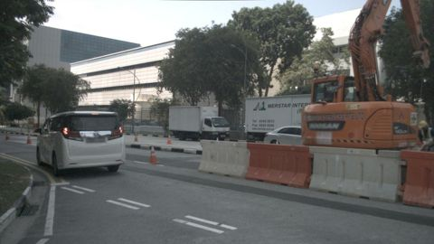
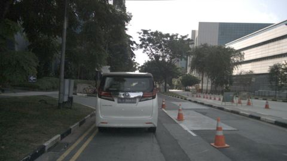
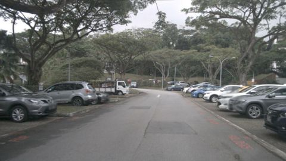

# VLM evaluation report: `mock-always_car` with prompt `v2_structured@7f47e762`

50 frames from 10 scenes. Ground truth comes from nuScenes annotations (objects), `scene.description` (time of day, road condition, scene type) and `log.location` (traffic side).

## Headline numbers

| Metric | Value |
|---|---|
| Object presence: micro F1 | 64.1% |
|   ↳ blind baseline (always claims the frequent classes, never looks) | 54.7% |
| Object presence: precision | 71.7% |
| Object presence: recall | 57.9% |
| Hallucination rate (claimed class with no box in view) | 26.0% |
| Omission rate (clearly visible class not mentioned) | 42.1% |
| Count bucket accuracy (exact) | 53.0% |
| Count bucket accuracy within ±1 | 80.3% |
| Scene attributes: mean balanced accuracy | 45.8% |
| Free-text claims: micro F1 | 64.1% |
| Prose claims an object the structured answer denies | 0.0% |
| Valid structured output | 100.0% |
| Mean latency per frame (s) | 0.00 |

## How far to trust the ground truth

A sample of frames was labelled by eye and compared with the automatic GT. Metrics on a field cannot be trusted beyond its agreement: treat low-agreement fields as indicative only.

| Field | Labels checked | Auto vs. manual agreement |
|---|---|---|
| all | 130 | 86.9% |
| objects | 91 | 89.0% |
| road_condition | 13 | 92.3% |
| scene_type | 13 | 53.8% |
| time_of_day | 13 | 100.0% |

## Objects: hallucination vs. omission

Per frame and class: claimed vs. present (≥40% visible, ≤50 m). `FP` = claimed but no box of that class anywhere in the image (hallucination); `FP far` = a box exists but is far or mostly occluded (excused in *precision*, counted in *precision strict*).

| Class | GT frames | TP | FP | FP far | FN | Precision | Precision strict | Recall | F1 |
|---|---|---|---|---|---|---|---|---|---|
| car | 44 | 44 | 3 | 3 | 0 | 93.6% | 88.0% | 100.0% | 96.7% |
| truck | 12 | 0 | 0 | 0 | 12 | – | – | 0.0% | 0.0% |
| bus | 7 | 0 | 0 | 0 | 7 | – | – | 0.0% | 0.0% |
| pedestrian | 22 | 22 | 23 | 5 | 0 | 48.9% | 44.0% | 100.0% | 65.7% |
| two_wheeler | 12 | 0 | 0 | 0 | 12 | – | – | 0.0% | 0.0% |
| traffic_cone | 8 | 0 | 0 | 0 | 8 | – | – | 0.0% | 0.0% |
| barrier | 9 | 0 | 0 | 0 | 9 | – | – | 0.0% | 0.0% |

**Recall by object visibility** (all annotated objects in view)

| Visibility | Objects | Recall |
|---|---|---|
| 0-40% | 165 | 69.7% |
| 40-60% | 69 | 76.8% |
| 60-80% | 63 | 69.8% |
| 80-100% | 322 | 61.8% |

**Recall by distance**

| Distance | Objects | Recall |
|---|---|---|
| 0-15m | 68 | 66.2% |
| 15-30m | 197 | 68.0% |
| 30-50m | 189 | 61.9% |
| 50m+ | 165 | 69.7% |

## Counting

Only frames where GT and prediction both say the class is present (buckets 1-2 / 3-5 / 6+).

| Class | Frames | Exact bucket | Within ±1 bucket |
|---|---|---|---|
| car | 44 | 52.3% | 81.8% |
| pedestrian | 22 | 54.5% | 77.3% |

## Scene attributes

Accuracy counts unanswered fields as wrong. Compare against the majority-class baseline: with a skewed GT, a model that always says "day" looks good on raw accuracy but gets 50% balanced accuracy.

| Attribute | Accuracy | Balanced acc. | Majority baseline | Answered | GT distribution |
|---|---|---|---|---|---|
| time_of_day | 70.0% | 50.0% | 70.0% | 100.0% | day: 35, night: 15 |
| road_condition | 90.0% | 50.0% | 90.0% | 100.0% | dry: 45, wet: 5 |
| scene_type | 40.0% | 33.3% | 40.0% | 100.0% | intersection: 20, road: 20, parking_lot: 10 |
| traffic_side | 40.0% | 50.0% | 60.0% | 100.0% | left: 30, right: 20 |

Confusion:
- **time_of_day**: GT day → day: 35; GT night → day: 15
- **road_condition**: GT dry → dry: 45; GT wet → dry: 5
- **scene_type**: GT intersection → road: 20; GT parking_lot → road: 10; GT road → road: 20
- **traffic_side**: GT left → right: 30; GT right → right: 20

## Free-text faithfulness

| Metric | Value |
|---|---|
| Claims in prose: precision | 71.7% |
| Claims in prose: recall | 57.9% |
| Claims in prose: hallucination rate | 26.0% |
| Prose object claims the structured answer denies | 0.0% |
| Prose ↔ structured attribute agreement | 100.0% |

Claims are extracted from the description with a rule-based lexicon (see parsing/text_claims.py). Agreement is computed for structured answers (JSON or questionnaire).

## Slices

Headline metrics per ground-truth condition. Slices are defined on ground truth. Small slices have wide uncertainty; check the frame count before drawing conclusions.

**By time_of_day**

| Slice | Frames | Object F1 | Recall | Hallucination | Attribute acc. |
|---|---|---|---|---|---|
| day | 35 | 59.1% | 51.2% | 27.1% | 67.9% |
| night | 15 | 77.2% | 78.6% | 23.3% | 41.7% |

**By location**

| Slice | Frames | Object F1 | Recall | Hallucination | Attribute acc. |
|---|---|---|---|---|---|
| boston-seaport | 20 | 59.8% | 51.0% | 25.0% | 81.2% |
| singapore-hollandvillage | 15 | 77.2% | 78.6% | 23.3% | 41.7% |
| singapore-onenorth | 5 | 55.2% | 40.0% | 10.0% | 50.0% |
| singapore-queenstown | 10 | 60.6% | 66.7% | 40.0% | 50.0% |

**By scene_type**

| Slice | Frames | Object F1 | Recall | Hallucination | Attribute acc. |
|---|---|---|---|---|---|
| intersection | 20 | 57.1% | 47.3% | 25.0% | 62.5% |
| parking_lot | 10 | 54.1% | 52.6% | 40.0% | 62.5% |
| road | 20 | 76.9% | 75.0% | 20.0% | 56.2% |

## Temporal consistency

How often a label changes between consecutive sampled frames of the same scene.

| Label | Model flip rate | GT flip rate |
|---|---|---|
| time_of_day | 0.0% | 0.0% |
| road_condition | 0.0% | 0.0% |
| scene_type | 0.0% | 0.0% |
| traffic_side | 0.0% | 0.0% |
| obj:car | 0.0% | 20.0% |
| obj:truck | 0.0% | 37.5% |
| obj:bus | 0.0% | 15.0% |
| obj:pedestrian | 0.0% | 22.5% |
| obj:two_wheeler | 0.0% | 32.5% |
| obj:traffic_cone | 0.0% | 15.0% |
| obj:barrier | 0.0% | 10.0% |

Scene-level GT attributes never change within a scene, so any attribute flip by the model is an inconsistency.

## Similarity to the human reference (secondary)

`scene.description` describes a 20 s scene in keywords, not this frame, so similarity is a weak proxy. A low correlation with the claim-level F1 shows that similarity does not track correctness.

| Metric | Value |
|---|---|
| Reference keyword recall (classes in scene.description that are mentioned) | 45.7% |
| Mean embedding cosine to scene.description | 0.26 |
| Pearson(cosine, frame object F1) | -0.04 |
| Spearman(cosine, frame object F1) | -0.16 |

## Error taxonomy

Frames with at least one error: 100.0%

| Error family | Count |
|---|---|
| attribute | 80 |
| omission | 48 |
| hallucination | 26 |
| count | 13 |

| Most frequent errors | Count |
|---|---|
| attribute:scene_type | 30 |
| attribute:traffic_side | 30 |
| hallucination:pedestrian | 23 |
| attribute:time_of_day | 15 |
| omission:truck | 12 |
| omission:two_wheeler | 12 |
| omission:barrier | 9 |
| omission:traffic_cone | 8 |
| count:car | 8 |
| omission:bus | 7 |
| count:pedestrian | 5 |
| attribute:road_condition | 5 |
| hallucination:car | 3 |

### Worst frames

**scene-0061 / frame 10**: `omission:truck`, `count:pedestrian`, `omission:traffic_cone`, `omission:barrier`, `attribute:scene_type`, `attribute:traffic_side`

> A car and a pedestrian on a sunny road.

GT objects: `{'pedestrian': '6+', 'car': '3-5', 'barrier': '3-5', 'truck': '1-2', 'traffic_cone': '3-5'}`, predicted: `{'car': '1-2', 'pedestrian': '1-2'}`

**scene-0757 / frame 0**: `hallucination:car`, `omission:truck`, `omission:bus`, `hallucination:pedestrian`, `omission:traffic_cone`, `attribute:scene_type`

> A car and a pedestrian on a sunny road.

GT objects: `{'traffic_cone': '1-2', 'bus': '1-2', 'truck': '1-2'}`, predicted: `{'car': '1-2', 'pedestrian': '1-2'}`

**scene-0061 / frame 19**: `omission:truck`, `omission:traffic_cone`, `omission:barrier`, `attribute:scene_type`, `attribute:traffic_side`

> A car and a pedestrian on a sunny road.

GT objects: `{'truck': '3-5', 'traffic_cone': '6+', 'pedestrian': '1-2', 'barrier': '3-5', 'car': '1-2'}`, predicted: `{'car': '1-2', 'pedestrian': '1-2'}`

**scene-0061 / frame 28**: `hallucination:pedestrian`, `omission:two_wheeler`, `omission:traffic_cone`, `attribute:scene_type`, `attribute:traffic_side`

> A car and a pedestrian on a sunny road.

GT objects: `{'traffic_cone': '6+', 'two_wheeler': '1-2', 'car': '1-2'}`, predicted: `{'car': '1-2', 'pedestrian': '1-2'}`

**scene-0655 / frame 20**: `omission:truck`, `omission:bus`, `hallucination:pedestrian`, `omission:traffic_cone`, `attribute:scene_type`

> A car and a pedestrian on a sunny road.

GT objects: `{'car': '1-2', 'bus': '1-2', 'traffic_cone': '1-2', 'truck': '1-2'}`, predicted: `{'car': '1-2', 'pedestrian': '1-2'}`

**scene-0916 / frame 20**: `count:car`, `omission:truck`, `hallucination:pedestrian`, `attribute:scene_type`, `attribute:traffic_side`

> A car and a pedestrian on a sunny road.

GT objects: `{'car': '6+', 'truck': '1-2'}`, predicted: `{'car': '1-2', 'pedestrian': '1-2'}`

**scene-1094 / frame 10**: `count:pedestrian`, `omission:two_wheeler`, `attribute:time_of_day`, `attribute:road_condition`, `attribute:traffic_side`

> A car and a pedestrian on a sunny road.

GT objects: `{'car': '3-5', 'pedestrian': '6+', 'two_wheeler': '1-2'}`, predicted: `{'car': '1-2', 'pedestrian': '1-2'}`

**scene-0061 / frame 0**: `omission:truck`, `omission:barrier`, `attribute:scene_type`, `attribute:traffic_side`

> A car and a pedestrian on a sunny road.

GT objects: `{'pedestrian': '3-5', 'barrier': '6+', 'car': '3-5', 'truck': '1-2'}`, predicted: `{'car': '1-2', 'pedestrian': '1-2'}`
