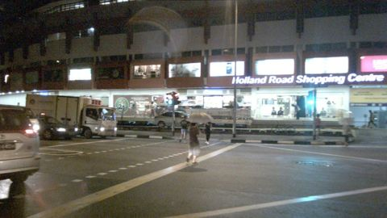
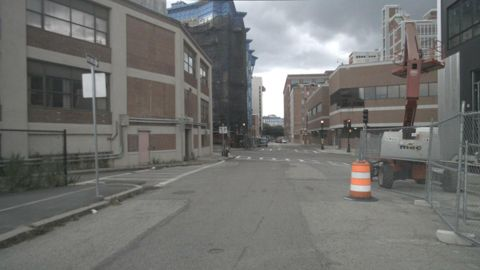
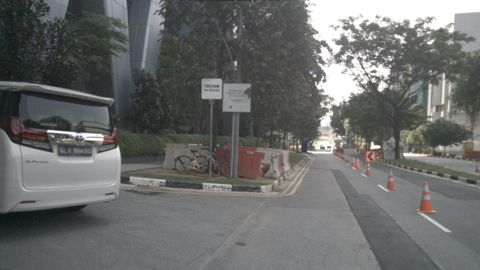

# VLM evaluation report: `Qwen2-VL-2B-Instruct` with prompt `v2_structured@7f47e762`

50 frames from 10 scenes. Ground truth comes from nuScenes annotations (objects), `scene.description` (time of day, road condition, scene type) and `log.location` (traffic side).

## Headline numbers

| Metric | Value |
|---|---|
| Object presence: micro F1 | 59.1% |
|   ↳ blind baseline (always claims the frequent classes, never looks) | 54.7% |
| Object presence: precision | 83.9% |
| Object presence: recall | 45.6% |
| Hallucination rate (claimed class with no box in view) | 15.2% |
| Omission rate (clearly visible class not mentioned) | 54.4% |
| Count bucket accuracy (exact) | 51.9% |
| Count bucket accuracy within ±1 | 86.5% |
| Scene attributes: mean balanced accuracy | 73.6% |
| Free-text claims: micro F1 | 69.1% |
| Prose claims an object the structured answer denies | 23.0% |
| Valid structured output | 96.0% |
| Mean latency per frame (s) | 4.12 |

## Objects: hallucination vs. omission

Per frame and class: claimed vs. present (≥40% visible, ≤50 m). `FP` = claimed but no box of that class anywhere in the image (hallucination); `FP far` = a box exists but is far or mostly occluded (excused in *precision*, counted in *precision strict*).

| Class | GT frames | TP | FP | FP far | FN | Precision | Precision strict | Recall | F1 |
|---|---|---|---|---|---|---|---|---|---|
| car | 44 | 32 | 1 | 1 | 12 | 97.0% | 94.1% | 72.7% | 83.1% |
| truck | 12 | 6 | 3 | 1 | 6 | 66.7% | 60.0% | 50.0% | 57.1% |
| bus | 7 | 1 | 0 | 2 | 6 | 100.0% | 33.3% | 14.3% | 25.0% |
| pedestrian | 22 | 8 | 3 | 0 | 14 | 72.7% | 72.7% | 36.4% | 48.5% |
| two_wheeler | 12 | 2 | 1 | 0 | 10 | 66.7% | 66.7% | 16.7% | 26.7% |
| traffic_cone | 8 | 2 | 0 | 0 | 6 | 100.0% | 100.0% | 25.0% | 40.0% |
| barrier | 9 | 1 | 2 | 0 | 8 | 33.3% | 33.3% | 11.1% | 16.7% |

**Recall by object visibility** (all annotated objects in view)

| Visibility | Objects | Recall |
|---|---|---|
| 0-40% | 165 | 57.6% |
| 40-60% | 69 | 60.9% |
| 60-80% | 63 | 47.6% |
| 80-100% | 322 | 51.9% |

**Recall by distance**

| Distance | Objects | Recall |
|---|---|---|
| 0-15m | 68 | 66.2% |
| 15-30m | 197 | 47.7% |
| 30-50m | 189 | 54.5% |
| 50m+ | 165 | 55.8% |

## Counting

Only frames where GT and prediction both say the class is present (buckets 1-2 / 3-5 / 6+).

| Class | Frames | Exact bucket | Within ±1 bucket |
|---|---|---|---|
| car | 32 | 46.9% | 81.2% |
| truck | 6 | 83.3% | 100.0% |
| bus | 1 | 100.0% | 100.0% |
| pedestrian | 8 | 50.0% | 100.0% |
| two_wheeler | 2 | 100.0% | 100.0% |
| traffic_cone | 2 | 0.0% | 50.0% |
| barrier | 1 | 0.0% | 100.0% |

## Scene attributes

Accuracy counts unanswered fields as wrong. Compare against the majority-class baseline: with a skewed GT, a model that always says "day" looks good on raw accuracy but gets 50% balanced accuracy.

| Attribute | Accuracy | Balanced acc. | Majority baseline | Answered | GT distribution |
|---|---|---|---|---|---|
| time_of_day | 100.0% | 100.0% | 70.0% | 100.0% | day: 35, night: 15 |
| road_condition | 60.0% | 77.8% | 90.0% | 100.0% | dry: 45, wet: 5 |
| scene_type | 58.0% | 55.0% | 40.0% | 100.0% | intersection: 20, road: 20, parking_lot: 10 |
| traffic_side | 58.0% | 61.7% | 60.0% | 98.0% | left: 30, right: 20 |

Confusion:
- **time_of_day**: GT day → day: 35; GT night → night: 15
- **road_condition**: GT dry → dry: 25, wet: 20; GT wet → wet: 5
- **scene_type**: GT intersection → intersection: 18, road: 2; GT parking_lot → intersection: 6, parking_lot: 4; GT road → intersection: 13, road: 7
- **traffic_side**: GT left → left: 13, right: 16, unanswered: 1; GT right → right: 16, left: 4

## Free-text faithfulness

| Metric | Value |
|---|---|
| Claims in prose: precision | 87.8% |
| Claims in prose: recall | 57.0% |
| Claims in prose: hallucination rate | 11.7% |
| Prose object claims the structured answer denies | 23.0% |
| Prose ↔ structured attribute agreement | 69.1% |

Claims are extracted from the description with a rule-based lexicon (see parsing/text_claims.py). Agreement is computed for structured answers (JSON or questionnaire).

## Slices

Headline metrics per ground-truth condition. Slices are defined on ground truth. Small slices have wide uncertainty; check the frame count before drawing conclusions.

**By time_of_day**

| Slice | Frames | Object F1 | Recall | Hallucination | Attribute acc. |
|---|---|---|---|---|---|
| day | 35 | 57.6% | 44.2% | 16.7% | 74.3% |
| night | 15 | 63.6% | 50.0% | 11.1% | 56.7% |

**By location**

| Slice | Frames | Object F1 | Recall | Hallucination | Attribute acc. |
|---|---|---|---|---|---|
| boston-seaport | 20 | 58.7% | 43.1% | 8.0% | 76.2% |
| singapore-hollandvillage | 15 | 63.6% | 50.0% | 11.1% | 56.7% |
| singapore-onenorth | 5 | 55.2% | 40.0% | 11.1% | 80.0% |
| singapore-queenstown | 10 | 57.1% | 53.3% | 35.7% | 67.5% |

**By scene_type**

| Slice | Frames | Object F1 | Recall | Hallucination | Attribute acc. |
|---|---|---|---|---|---|
| intersection | 20 | 58.1% | 45.5% | 18.8% | 77.5% |
| parking_lot | 10 | 50.0% | 36.8% | 20.0% | 70.0% |
| road | 20 | 64.5% | 50.0% | 8.3% | 60.0% |

## Temporal consistency

How often a label changes between consecutive sampled frames of the same scene.

| Label | Model flip rate | GT flip rate |
|---|---|---|
| time_of_day | 0.0% | 0.0% |
| road_condition | 35.0% | 0.0% |
| scene_type | 10.0% | 0.0% |
| traffic_side | 25.0% | 0.0% |
| obj:car | 47.5% | 20.0% |
| obj:truck | 32.5% | 37.5% |
| obj:bus | 7.5% | 15.0% |
| obj:pedestrian | 35.0% | 22.5% |
| obj:two_wheeler | 10.0% | 32.5% |
| obj:traffic_cone | 5.0% | 15.0% |
| obj:barrier | 7.5% | 10.0% |

Scene-level GT attributes never change within a scene, so any attribute flip by the model is an inconsistency.

## Similarity to the human reference (secondary)

`scene.description` describes a 20 s scene in keywords, not this frame, so similarity is a weak proxy. A low correlation with the claim-level F1 shows that similarity does not track correctness.

| Metric | Value |
|---|---|
| Reference keyword recall (classes in scene.description that are mentioned) | 29.9% |
| Mean embedding cosine to scene.description | 0.36 |
| Pearson(cosine, frame object F1) | -0.03 |
| Spearman(cosine, frame object F1) | 0.01 |

## Error taxonomy

Frames with at least one error: 100.0%

| Error family | Count |
|---|---|
| omission | 62 |
| attribute | 61 |
| consistency | 11 |
| hallucination | 10 |
| count | 7 |
| format | 2 |

| Most frequent errors | Count |
|---|---|
| attribute:scene_type | 21 |
| attribute:road_condition | 20 |
| attribute:traffic_side | 20 |
| omission:pedestrian | 14 |
| omission:car | 12 |
| consistency:text_contradicts_json | 11 |
| omission:two_wheeler | 10 |
| omission:barrier | 8 |
| omission:truck | 6 |
| omission:traffic_cone | 6 |
| count:car | 6 |
| omission:bus | 6 |
| hallucination:truck | 3 |
| hallucination:pedestrian | 3 |
| format:invalid_output | 2 |

### Worst frames

**scene-0061 / frame 10**: `omission:truck`, `omission:pedestrian`, `omission:traffic_cone`, `omission:barrier`, `attribute:road_condition`, `attribute:traffic_side`

> A white car is driving on a wet road with a construction site in the background.

GT objects: `{'pedestrian': '6+', 'car': '3-5', 'barrier': '3-5', 'truck': '1-2', 'traffic_cone': '3-5'}`, predicted: `{'car': '1-2'}`

**scene-0655 / frame 20**: `omission:car`, `omission:truck`, `omission:bus`, `omission:traffic_cone`, `attribute:road_condition`, `attribute:scene_type`

> The scene shows a street with a large building on the right and a smaller building on the left. There are no cars or trucks visible, and no pedestrians are present. The road is wet, and there are no traffic cones or barriers. The scene type is an intersection.

GT objects: `{'car': '1-2', 'bus': '1-2', 'traffic_cone': '1-2', 'truck': '1-2'}`, predicted: `{}`

**scene-0655 / frame 30**: `omission:truck`, `omission:bus`, `omission:pedestrian`, `omission:traffic_cone`, `attribute:scene_type`, `consistency:text_contradicts_json`

> A road with a truck and a bus, with traffic cones and a construction zone in the middle. The sky is clear.

GT objects: `{'truck': '1-2', 'pedestrian': '1-2', 'traffic_cone': '3-5', 'bus': '1-2'}`, predicted: `{}`

**scene-1094 / frame 10**: `omission:car`, `omission:pedestrian`, `omission:two_wheeler`, `attribute:scene_type`, `attribute:traffic_side`, `consistency:text_contradicts_json`

> The scene is a wet intersection with a Holland Road Shopping Centre in the background. There are no cars, trucks, buses, pedestrians, two-wheelers, or traffic cones visible.

GT objects: `{'car': '3-5', 'pedestrian': '6+', 'two_wheeler': '1-2'}`, predicted: `{}`

**scene-0061 / frame 28**: `omission:car`, `omission:two_wheeler`, `hallucination:barrier`, `attribute:road_condition`, `consistency:text_contradicts_json`

> A white van is parked on the left side of a road with orange traffic cones and barriers. The road appears to be wet.

GT objects: `{'traffic_cone': '6+', 'two_wheeler': '1-2', 'car': '1-2'}`, predicted: `{'traffic_cone': '3-5', 'barrier': '1-2'}`

**scene-0757 / frame 0**: `omission:truck`, `omission:bus`, `omission:traffic_cone`, `attribute:road_condition`, `consistency:text_contradicts_json`

> The scene is a street with a construction zone in the middle, with a crane and a truck parked on the right side. The road is wet, and there are no visible cars or pedestrians.

GT objects: `{'traffic_cone': '1-2', 'bus': '1-2', 'truck': '1-2'}`, predicted: `{}`

**scene-0061 / frame 38**: `omission:car`, `omission:two_wheeler`, `omission:traffic_cone`, `consistency:text_contradicts_json`

> A white car is parked on the left side of a street with construction cones and barriers. There are no other vehicles or pedestrians visible.

GT objects: `{'traffic_cone': '6+', 'two_wheeler': '1-2', 'car': '1-2'}`, predicted: `{}`

**scene-0103 / frame 0**: `omission:pedestrian`, `attribute:road_condition`, `attribute:scene_type`, `consistency:text_contradicts_json`

> The scene is a busy urban intersection with tall buildings on both sides. There are cars, pedestrians, and traffic lights visible. The road appears to be wet.

GT objects: `{'pedestrian': '6+', 'car': '1-2'}`, predicted: `{'car': '1-2'}`
