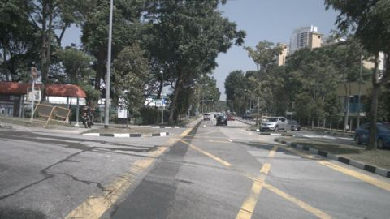
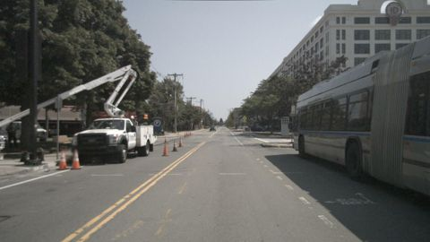
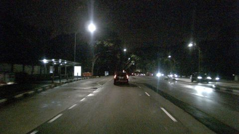

# VLM evaluation report: `Qwen2-VL-2B-Instruct` with prompt `v2b_structured@db8db50a`

50 frames from 10 scenes. Ground truth comes from nuScenes annotations (objects), `scene.description` (time of day, road condition, scene type) and `log.location` (traffic side).

## Headline numbers

| Metric | Value |
|---|---|
| Object presence: micro F1 | 35.1% |
|   ↳ blind baseline (always claims the frequent classes, never looks) | 54.7% |
| Object presence: precision | 76.5% |
| Object presence: recall | 22.8% |
| Hallucination rate (claimed class with no box in view) | 21.1% |
| Omission rate (clearly visible class not mentioned) | 77.2% |
| Count bucket accuracy (exact) | 80.8% |
| Count bucket accuracy within ±1 | 100.0% |
| Scene attributes: mean balanced accuracy | 70.4% |
| Free-text claims: micro F1 | 70.8% |
| Prose claims an object the structured answer denies | 73.6% |
| Valid structured output | 100.0% |
| Mean latency per frame (s) | 4.72 |

## How far to trust the ground truth

A sample of frames was labelled by eye and compared with the automatic GT. Metrics on a field cannot be trusted beyond its agreement: treat low-agreement fields as indicative only.

| Field | Labels checked | Auto vs. manual agreement |
|---|---|---|
| all | 130 | 86.9% |
| objects | 91 | 89.0% |
| road_condition | 13 | 92.3% |
| scene_type | 13 | 53.8% |
| time_of_day | 13 | 100.0% |

## Objects: hallucination vs. omission

Per frame and class: claimed vs. present (≥40% visible, ≤50 m). `FP` = claimed but no box of that class anywhere in the image (hallucination); `FP far` = a box exists but is far or mostly occluded (excused in *precision*, counted in *precision strict*).

| Class | GT frames | TP | FP | FP far | FN | Precision | Precision strict | Recall | F1 |
|---|---|---|---|---|---|---|---|---|---|
| car | 44 | 9 | 0 | 1 | 35 | 100.0% | 90.0% | 20.5% | 34.0% |
| truck | 12 | 7 | 3 | 1 | 5 | 70.0% | 63.6% | 58.3% | 63.6% |
| bus | 7 | 1 | 0 | 1 | 6 | 100.0% | 50.0% | 14.3% | 25.0% |
| pedestrian | 22 | 5 | 1 | 1 | 17 | 83.3% | 71.4% | 22.7% | 35.7% |
| two_wheeler | 12 | 2 | 0 | 0 | 10 | 100.0% | 100.0% | 16.7% | 28.6% |
| traffic_cone | 8 | 2 | 1 | 0 | 6 | 66.7% | 66.7% | 25.0% | 36.4% |
| barrier | 9 | 0 | 3 | 0 | 9 | 0.0% | 0.0% | 0.0% | 0.0% |

**Recall by object visibility** (all annotated objects in view)

| Visibility | Objects | Recall |
|---|---|---|
| 0-40% | 165 | 23.6% |
| 40-60% | 69 | 30.4% |
| 60-80% | 63 | 25.4% |
| 80-100% | 322 | 23.0% |

**Recall by distance**

| Distance | Objects | Recall |
|---|---|---|
| 0-15m | 68 | 29.4% |
| 15-30m | 197 | 22.8% |
| 30-50m | 189 | 21.2% |
| 50m+ | 165 | 27.3% |

## Counting

Only frames where GT and prediction both say the class is present (buckets 1-2 / 3-5 / 6+).

| Class | Frames | Exact bucket | Within ±1 bucket |
|---|---|---|---|
| car | 9 | 55.6% | 100.0% |
| truck | 7 | 85.7% | 100.0% |
| bus | 1 | 100.0% | 100.0% |
| pedestrian | 5 | 100.0% | 100.0% |
| two_wheeler | 2 | 100.0% | 100.0% |
| traffic_cone | 2 | 100.0% | 100.0% |

## Scene attributes

Accuracy counts unanswered fields as wrong. Compare against the majority-class baseline: with a skewed GT, a model that always says "day" looks good on raw accuracy but gets 50% balanced accuracy.

| Attribute | Accuracy | Balanced acc. | Majority baseline | Answered | GT distribution |
|---|---|---|---|---|---|
| time_of_day | 100.0% | 100.0% | 70.0% | 100.0% | day: 35, night: 15 |
| road_condition | 46.0% | 70.0% | 90.0% | 100.0% | dry: 45, wet: 5 |
| scene_type | 52.0% | 50.0% | 40.0% | 100.0% | intersection: 20, road: 20, parking_lot: 10 |
| traffic_side | 54.0% | 61.7% | 60.0% | 100.0% | left: 30, right: 20 |

Confusion:
- **time_of_day**: GT day → day: 35; GT night → night: 15
- **road_condition**: GT dry → wet: 27, dry: 18; GT wet → wet: 5
- **scene_type**: GT intersection → intersection: 17, road: 3; GT parking_lot → intersection: 5, parking_lot: 4, road: 1; GT road → intersection: 14, road: 5, parking_lot: 1
- **traffic_side**: GT left → right: 23, left: 7; GT right → right: 20

## Free-text faithfulness

| Metric | Value |
|---|---|
| Claims in prose: precision | 66.7% |
| Claims in prose: recall | 75.4% |
| Claims in prose: hallucination rate | 30.7% |
| Prose object claims the structured answer denies | 73.6% |
| Prose ↔ structured attribute agreement | 81.6% |

Claims are extracted from the description with a rule-based lexicon (see parsing/text_claims.py). Agreement is computed for structured answers (JSON or questionnaire).

## Slices

Headline metrics per ground-truth condition. Slices are defined on ground truth. Small slices have wide uncertainty; check the frame count before drawing conclusions.

**By time_of_day**

| Slice | Frames | Object F1 | Recall | Hallucination | Attribute acc. |
|---|---|---|---|---|---|
| day | 35 | 38.6% | 25.6% | 18.8% | 70.7% |
| night | 15 | 23.5% | 14.3% | 33.3% | 45.0% |

**By location**

| Slice | Frames | Object F1 | Recall | Hallucination | Attribute acc. |
|---|---|---|---|---|---|
| boston-seaport | 20 | 34.9% | 21.6% | 6.2% | 73.8% |
| singapore-hollandvillage | 15 | 23.5% | 14.3% | 33.3% | 45.0% |
| singapore-onenorth | 5 | 53.3% | 40.0% | 20.0% | 70.0% |
| singapore-queenstown | 10 | 28.6% | 20.0% | 50.0% | 65.0% |

**By scene_type**

| Slice | Frames | Object F1 | Recall | Hallucination | Attribute acc. |
|---|---|---|---|---|---|
| intersection | 20 | 45.6% | 32.7% | 24.0% | 75.0% |
| parking_lot | 10 | 34.8% | 21.1% | 0.0% | 65.0% |
| road | 20 | 17.4% | 10.0% | 28.6% | 50.0% |

## Temporal consistency

How often a label changes between consecutive sampled frames of the same scene.

| Label | Model flip rate | GT flip rate |
|---|---|---|
| time_of_day | 0.0% | 0.0% |
| road_condition | 37.5% | 0.0% |
| scene_type | 25.0% | 0.0% |
| traffic_side | 20.0% | 0.0% |
| obj:car | 37.5% | 20.0% |
| obj:truck | 35.0% | 37.5% |
| obj:bus | 10.0% | 15.0% |
| obj:pedestrian | 25.0% | 22.5% |
| obj:two_wheeler | 5.0% | 32.5% |
| obj:traffic_cone | 7.5% | 15.0% |
| obj:barrier | 7.5% | 10.0% |

Scene-level GT attributes never change within a scene, so any attribute flip by the model is an inconsistency.

## Similarity to the human reference (secondary)

`scene.description` describes a 20 s scene in keywords, not this frame, so similarity is a weak proxy. A low correlation with the claim-level F1 shows that similarity does not track correctness.

| Metric | Value |
|---|---|
| Reference keyword recall (classes in scene.description that are mentioned) | 46.9% |
| Mean embedding cosine to scene.description | 0.41 |
| Pearson(cosine, frame object F1) | 0.23 |
| Spearman(cosine, frame object F1) | 0.34 |

## Error taxonomy

Frames with at least one error: 100.0%

| Error family | Count |
|---|---|
| omission | 88 |
| attribute | 74 |
| consistency | 43 |
| hallucination | 8 |

| Most frequent errors | Count |
|---|---|
| consistency:text_contradicts_json | 43 |
| omission:car | 35 |
| attribute:road_condition | 27 |
| attribute:scene_type | 24 |
| attribute:traffic_side | 23 |
| omission:pedestrian | 17 |
| omission:two_wheeler | 10 |
| omission:barrier | 9 |
| omission:traffic_cone | 6 |
| omission:bus | 6 |
| omission:truck | 5 |
| hallucination:barrier | 3 |
| hallucination:truck | 3 |
| hallucination:traffic_cone | 1 |
| hallucination:pedestrian | 1 |

### Worst frames

**scene-0061 / frame 19**: `omission:car`, `omission:pedestrian`, `omission:traffic_cone`, `omission:barrier`, `attribute:road_condition`, `attribute:traffic_side`, `consistency:text_contradicts_json`

> A car is driving on a wet road with orange traffic cones and barriers, and a truck is parked on the side of the road.

GT objects: `{'truck': '3-5', 'traffic_cone': '6+', 'pedestrian': '1-2', 'barrier': '3-5', 'car': '1-2'}`, predicted: `{'truck': '1-2'}`

**scene-0655 / frame 20**: `omission:car`, `omission:truck`, `omission:bus`, `omission:traffic_cone`, `attribute:road_condition`, `attribute:scene_type`, `consistency:text_contradicts_json`

> The image shows a street with a few vehicles, including a car, a truck, and a bus. There are no pedestrians or bicycles visible. The road is wet, and there are traffic cones and barriers on the side of the road.

GT objects: `{'car': '1-2', 'bus': '1-2', 'traffic_cone': '1-2', 'truck': '1-2'}`, predicted: `{}`

**scene-0796 / frame 10**: `hallucination:truck`, `omission:two_wheeler`, `hallucination:traffic_cone`, `hallucination:barrier`, `attribute:road_condition`, `attribute:traffic_side`, `consistency:text_contradicts_json`

> A busy intersection with multiple vehicles, including cars, trucks, and buses, driving on a wet road. There are barriers and traffic cones visible, and a pedestrian crossing the street.

GT objects: `{'car': '3-5', 'two_wheeler': '1-2'}`, predicted: `{'car': '6+', 'truck': '6+', 'traffic_cone': '6+', 'barrier': '6+'}`

**scene-0061 / frame 0**: `omission:car`, `omission:pedestrian`, `omission:barrier`, `attribute:road_condition`, `attribute:traffic_side`, `consistency:text_contradicts_json`

> A truck from Pokka Logistics is parked on the side of the road, with a pedestrian nearby. The road is wet, and there are orange traffic cones and barriers on the right side.

GT objects: `{'pedestrian': '3-5', 'barrier': '6+', 'car': '3-5', 'truck': '1-2'}`, predicted: `{'truck': '1-2'}`

**scene-0103 / frame 10**: `omission:car`, `omission:pedestrian`, `omission:traffic_cone`, `attribute:road_condition`, `attribute:scene_type`, `consistency:text_contradicts_json`

> A street scene with multiple cars, a truck, a bus, pedestrians, and traffic cones. The road is wet.

GT objects: `{'car': '6+', 'traffic_cone': '1-2', 'pedestrian': '3-5'}`, predicted: `{}`

**scene-0103 / frame 29**: `omission:car`, `omission:truck`, `omission:pedestrian`, `omission:two_wheeler`, `attribute:scene_type`, `consistency:text_contradicts_json`

> A street scene with parked cars, a truck, and a pedestrian on the right side of the road.

GT objects: `{'car': '6+', 'two_wheeler': '1-2', 'pedestrian': '1-2', 'truck': '1-2'}`, predicted: `{}`

**scene-0655 / frame 30**: `omission:bus`, `omission:pedestrian`, `omission:traffic_cone`, `attribute:road_condition`, `attribute:scene_type`, `consistency:text_contradicts_json`

> A road with a truck and a bus, with traffic cones and a barrier. The road is wet.

GT objects: `{'truck': '1-2', 'pedestrian': '1-2', 'traffic_cone': '3-5', 'bus': '1-2'}`, predicted: `{'truck': '1-2'}`

**scene-1077 / frame 30**: `omission:car`, `omission:barrier`, `attribute:road_condition`, `attribute:scene_type`, `attribute:traffic_side`, `consistency:text_contradicts_json`

> The image shows a wet road with a car driving on it, surrounded by streetlights and a bus stop. The scene is likely a parking lot or an intersection.

GT objects: `{'car': '1-2', 'barrier': '1-2'}`, predicted: `{}`
