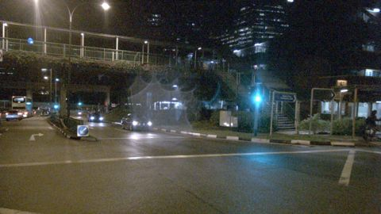
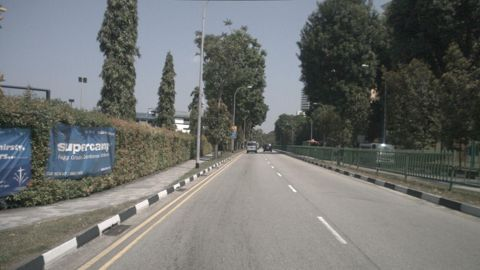
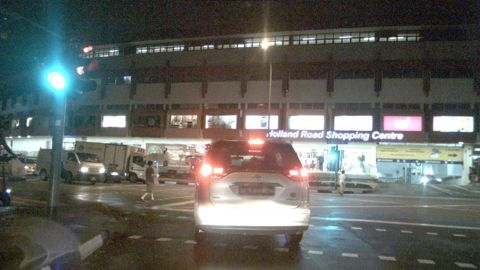
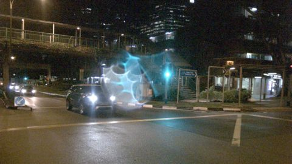

# VLM evaluation report: `Qwen2-VL-2B-Instruct` with prompt `v3_questionnaire@14414ec5`

50 frames from 10 scenes. Ground truth comes from nuScenes annotations (objects), `scene.description` (time of day, road condition, scene type) and `log.location` (traffic side).

## Headline numbers

| Metric | Value |
|---|---|
| Object presence: micro F1 | 73.4% |
|   ↳ blind baseline (always claims the frequent classes, never looks) | 54.7% |
| Object presence: precision | 70.7% |
| Object presence: recall | 76.3% |
| Hallucination rate (claimed class with no box in view) | 27.9% |
| Omission rate (clearly visible class not mentioned) | 23.7% |
| Count bucket accuracy (exact) | 67.8% |
| Count bucket accuracy within ±1 | 94.3% |
| Scene attributes: mean balanced accuracy | 71.2% |
| Free-text claims: micro F1 | 74.9% |
| Prose claims an object the structured answer denies | 18.3% |
| Valid structured output | 100.0% |
| Mean latency per frame (s) | 18.14 |

## Objects: hallucination vs. omission

Per frame and class: claimed vs. present (≥40% visible, ≤50 m). `FP` = claimed but no box of that class anywhere in the image (hallucination); `FP far` = a box exists but is far or mostly occluded (excused in *precision*, counted in *precision strict*).

| Class | GT frames | TP | FP | FP far | FN | Precision | Precision strict | Recall | F1 |
|---|---|---|---|---|---|---|---|---|---|
| car | 44 | 44 | 0 | 1 | 0 | 100.0% | 97.8% | 100.0% | 100.0% |
| truck | 12 | 11 | 7 | 2 | 1 | 61.1% | 55.0% | 91.7% | 73.3% |
| bus | 7 | 5 | 1 | 3 | 2 | 83.3% | 55.6% | 71.4% | 76.9% |
| pedestrian | 22 | 13 | 0 | 0 | 9 | 100.0% | 100.0% | 59.1% | 74.3% |
| two_wheeler | 12 | 1 | 0 | 0 | 11 | 100.0% | 100.0% | 8.3% | 15.4% |
| traffic_cone | 8 | 8 | 3 | 0 | 0 | 72.7% | 72.7% | 100.0% | 84.2% |
| barrier | 9 | 5 | 25 | 0 | 4 | 16.7% | 16.7% | 55.6% | 25.6% |

**Recall by object visibility** (all annotated objects in view)

| Visibility | Objects | Recall |
|---|---|---|
| 0-40% | 165 | 80.6% |
| 40-60% | 69 | 81.2% |
| 60-80% | 63 | 81.0% |
| 80-100% | 322 | 85.4% |

**Recall by distance**

| Distance | Objects | Recall |
|---|---|---|
| 0-15m | 68 | 91.2% |
| 15-30m | 197 | 86.3% |
| 30-50m | 189 | 86.2% |
| 50m+ | 165 | 72.7% |

## Counting

Only frames where GT and prediction both say the class is present (buckets 1-2 / 3-5 / 6+).

| Class | Frames | Exact bucket | Within ±1 bucket |
|---|---|---|---|
| car | 44 | 70.5% | 100.0% |
| truck | 11 | 90.9% | 100.0% |
| bus | 5 | 100.0% | 100.0% |
| pedestrian | 13 | 46.2% | 69.2% |
| two_wheeler | 1 | 0.0% | 100.0% |
| traffic_cone | 8 | 37.5% | 87.5% |
| barrier | 5 | 80.0% | 100.0% |

## Scene attributes

Accuracy counts unanswered fields as wrong. Compare against the majority-class baseline: with a skewed GT, a model that always says "day" looks good on raw accuracy but gets 50% balanced accuracy.

| Attribute | Accuracy | Balanced acc. | Majority baseline | Answered | GT distribution |
|---|---|---|---|---|---|
| time_of_day | 100.0% | 100.0% | 70.0% | 100.0% | day: 35, night: 15 |
| road_condition | 78.0% | 78.9% | 90.0% | 100.0% | dry: 45, wet: 5 |
| scene_type | 62.0% | 58.3% | 40.0% | 100.0% | intersection: 20, road: 20, parking_lot: 10 |
| traffic_side | 38.0% | 47.5% | 60.0% | 100.0% | left: 30, right: 20 |

Confusion:
- **time_of_day**: GT day → day: 35; GT night → night: 15
- **road_condition**: GT dry → dry: 35, wet: 10; GT wet → wet: 4, dry: 1
- **scene_type**: GT intersection → intersection: 16, road: 4; GT parking_lot → road: 6, parking_lot: 4; GT road → intersection: 9, road: 11
- **traffic_side**: GT left → right: 30; GT right → right: 19, left: 1

## Free-text faithfulness

| Metric | Value |
|---|---|
| Claims in prose: precision | 81.4% |
| Claims in prose: recall | 69.3% |
| Claims in prose: hallucination rate | 17.3% |
| Prose object claims the structured answer denies | 18.3% |
| Prose ↔ structured attribute agreement | 88.2% |

Claims are extracted from the description with a rule-based lexicon (see parsing/text_claims.py). Agreement is computed for structured answers (JSON or questionnaire).

## Slices

Headline metrics per ground-truth condition. Slices are defined on ground truth. Small slices have wide uncertainty; check the frame count before drawing conclusions.

**By time_of_day**

| Slice | Frames | Object F1 | Recall | Hallucination | Attribute acc. |
|---|---|---|---|---|---|
| day | 35 | 77.1% | 80.2% | 24.7% | 80.0% |
| night | 15 | 62.1% | 64.3% | 37.5% | 45.0% |

**By location**

| Slice | Frames | Object F1 | Recall | Hallucination | Attribute acc. |
|---|---|---|---|---|---|
| boston-seaport | 20 | 76.9% | 78.4% | 23.2% | 91.2% |
| singapore-hollandvillage | 15 | 62.1% | 64.3% | 37.5% | 45.0% |
| singapore-onenorth | 5 | 82.1% | 80.0% | 15.8% | 70.0% |
| singapore-queenstown | 10 | 72.2% | 86.7% | 36.4% | 62.5% |

**By scene_type**

| Slice | Frames | Object F1 | Recall | Hallucination | Attribute acc. |
|---|---|---|---|---|---|
| intersection | 20 | 73.9% | 74.5% | 25.9% | 82.5% |
| parking_lot | 10 | 81.8% | 94.7% | 25.9% | 67.5% |
| road | 20 | 68.3% | 70.0% | 31.8% | 57.5% |

## Temporal consistency

How often a label changes between consecutive sampled frames of the same scene.

| Label | Model flip rate | GT flip rate |
|---|---|---|
| time_of_day | 0.0% | 0.0% |
| road_condition | 12.5% | 0.0% |
| scene_type | 17.5% | 0.0% |
| traffic_side | 2.5% | 0.0% |
| obj:car | 15.0% | 20.0% |
| obj:truck | 20.0% | 37.5% |
| obj:bus | 22.5% | 15.0% |
| obj:pedestrian | 27.5% | 22.5% |
| obj:two_wheeler | 5.0% | 32.5% |
| obj:traffic_cone | 22.5% | 15.0% |
| obj:barrier | 40.0% | 10.0% |

Scene-level GT attributes never change within a scene, so any attribute flip by the model is an inconsistency.

## Similarity to the human reference (secondary)

`scene.description` describes a 20 s scene in keywords, not this frame, so similarity is a weak proxy. A low correlation with the claim-level F1 shows that similarity does not track correctness.

| Metric | Value |
|---|---|
| Reference keyword recall (classes in scene.description that are mentioned) | 42.7% |
| Mean embedding cosine to scene.description | 0.39 |
| Pearson(cosine, frame object F1) | 0.02 |
| Spearman(cosine, frame object F1) | 0.01 |

## Error taxonomy

Frames with at least one error: 96.0%

| Error family | Count |
|---|---|
| attribute | 61 |
| hallucination | 36 |
| omission | 27 |
| consistency | 16 |
| count | 5 |

| Most frequent errors | Count |
|---|---|
| attribute:traffic_side | 31 |
| hallucination:barrier | 25 |
| attribute:scene_type | 19 |
| consistency:text_contradicts_json | 16 |
| omission:two_wheeler | 11 |
| attribute:road_condition | 11 |
| omission:pedestrian | 9 |
| hallucination:truck | 7 |
| count:pedestrian | 4 |
| omission:barrier | 4 |
| hallucination:traffic_cone | 3 |
| omission:bus | 2 |
| count:traffic_cone | 1 |
| omission:truck | 1 |
| hallucination:bus | 1 |

### Worst frames

**scene-1094 / frame 10**: `hallucination:truck`, `count:pedestrian`, `omission:two_wheeler`, `hallucination:barrier`, `attribute:scene_type`, `attribute:traffic_side`

> The image depicts a nighttime scene at a busy intersection in a commercial area. The lighting is dim, with streetlights providing some illumination. The road is wet, suggesting recent rain, and there are visible puddles on the pavement. The Holland Road Shopping Centre is visible in the background, with its illuminated sign. Several vehicles, including trucks and cars, are present on the road, and pedestrians are walking on the sidewalks. The overall atmosphere is busy and somewhat chaotic, typical of a bustling urban environment.

GT objects: `{'car': '3-5', 'pedestrian': '6+', 'two_wheeler': '1-2'}`, predicted: `{'car': '1-2', 'truck': '1-2', 'pedestrian': '1-2', 'barrier': '1-2'}`

**scene-1100 / frame 10**: `omission:two_wheeler`, `hallucination:barrier`, `attribute:road_condition`, `attribute:scene_type`, `attribute:traffic_side`, `consistency:text_contradicts_json`

> The image depicts a nighttime scene in an urban area. The street is illuminated by streetlights and vehicle headlights, creating a bright, somewhat blurred glow. The road is wet, reflecting the lights and creating a reflective surface. There are several vehicles, including cars and a bus, visible on the road. The scene includes a pedestrian bridge with greenery on the left side, and a building with illuminated windows on the right. The overall atmosphere is busy yet somewhat chaotic, typical of a city at night.

GT objects: `{'car': '1-2', 'two_wheeler': '1-2'}`, predicted: `{'car': '1-2', 'bus': '1-2', 'barrier': '1-2'}`

**scene-1100 / frame 29**: `omission:pedestrian`, `hallucination:barrier`, `attribute:road_condition`, `attribute:scene_type`, `attribute:traffic_side`, `consistency:text_contradicts_json`

> The image depicts a nighttime urban scene with a focus on a street intersection. The lighting is dim, with streetlights and vehicle headlights illuminating the area. The road is wet, suggesting recent rain, and there are visible puddles on the pavement. The street is divided by a white line, and there are traffic signs and street signs visible. On the left side of the image, there is a pedestrian crossing with a blue sign, and on the right, there is a bus stop with a shelter and a sign indicating a bus route. The background features tall buildings with illuminated windows, indicating a busy urban area.

GT objects: `{'pedestrian': '1-2', 'car': '1-2'}`, predicted: `{'car': '1-2', 'barrier': '1-2'}`

**scene-0796 / frame 29**: `omission:truck`, `hallucination:barrier`, `attribute:scene_type`, `attribute:traffic_side`, `consistency:text_contradicts_json`

> The image depicts a quiet, suburban street in a well-maintained area. The sky is clear, suggesting a sunny day. The road is wide and appears to be in good condition, with clear lane markings and no visible potholes. On the left side of the road, there is a blue banner with white text, possibly advertising a business or event. The right side of the road is bordered by a green fence, and there are trees and shrubs along the sidewalk. A few vehicles are visible in the distance, including a car and a truck. The overall atmosphere is calm and orderly, typical of a residential or commercial neighborhood.

GT objects: `{'truck': '1-2'}`, predicted: `{'car': '1-2', 'barrier': '3-5'}`

**scene-1094 / frame 0**: `hallucination:truck`, `omission:two_wheeler`, `hallucination:barrier`, `attribute:scene_type`, `attribute:traffic_side`

> The image shows a nighttime scene at a busy intersection near the Holland Road Shopping Centre. The street is well-lit with multiple illuminated signs and lights, indicating a commercial area. The road is busy with various vehicles, including cars and a truck, and there are pedestrians walking on the sidewalks. The traffic lights are visible, and the overall atmosphere appears to be active and bustling.

GT objects: `{'pedestrian': '3-5', 'car': '3-5', 'two_wheeler': '1-2'}`, predicted: `{'car': '1-2', 'truck': '1-2', 'pedestrian': '1-2', 'barrier': '1-2'}`

**scene-1100 / frame 39**: `omission:pedestrian`, `hallucination:barrier`, `attribute:road_condition`, `attribute:scene_type`, `attribute:traffic_side`

> The image depicts a nighttime scene on a city street. The street is wet, indicating recent rain, and there are visible puddles on the road. The lighting is dim, with streetlights providing the primary source of illumination. There are several cars on the road, with their headlights on, creating a blue glow. The road is divided by a white line, and there are traffic lights visible in the distance. On the right side of the image, there is a bus stop with a sign, and a building with illuminated windows can be seen in the background. The overall atmosphere is quiet and calm, with no visible pedestrians or other road users.

GT objects: `{'pedestrian': '1-2', 'car': '1-2'}`, predicted: `{'car': '1-2', 'barrier': '1-2'}`

**scene-0061 / frame 0**: `omission:pedestrian`, `hallucination:traffic_cone`, `attribute:traffic_side`, `consistency:text_contradicts_json`

> The image depicts a street scene in an urban area, likely in a city with a mix of commercial and residential buildings. The lighting is bright, suggesting it is daytime with clear weather. There are several vehicles on the road, including a large truck with the logo "Pokka Logistics" on the side, and several cars. The road is marked with white lines and has a barrier on the right side, indicating a construction or roadwork zone. There are also pedestrians visible, and the overall atmosphere appears busy but orderly.

GT objects: `{'pedestrian': '3-5', 'barrier': '6+', 'car': '3-5', 'truck': '1-2'}`, predicted: `{'car': '3-5', 'truck': '1-2', 'traffic_cone': '6+', 'barrier': '3-5'}`

**scene-0061 / frame 38**: `omission:two_wheeler`, `hallucination:barrier`, `attribute:traffic_side`, `consistency:text_contradicts_json`

> The image shows a street scene in an urban area. The road is lined with trees and has construction barriers and orange traffic cones indicating ongoing work. There is a white car parked on the left side of the street, and a bicycle is parked on the grass median. The lighting is natural daylight, and the road appears to be in good condition with clear markings. There are no visible pedestrians or other road users in the immediate vicinity.

GT objects: `{'traffic_cone': '6+', 'two_wheeler': '1-2', 'car': '1-2'}`, predicted: `{'car': '1-2', 'traffic_cone': '3-5', 'barrier': '3-5'}`
