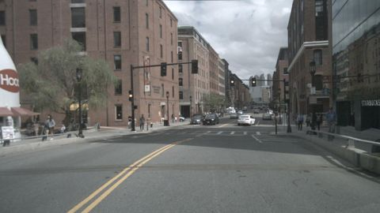
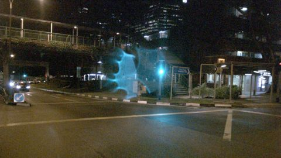

# VLM evaluation report: `SmolVLM-500M-Instruct` with prompt `v2_structured@7f47e762`

50 frames from 10 scenes. Ground truth comes from nuScenes annotations (objects), `scene.description` (time of day, road condition, scene type) and `log.location` (traffic side).

## Headline numbers

| Metric | Value |
|---|---|
| Object presence: micro F1 | 0.0% |
|   ↳ blind baseline (always claims the frequent classes, never looks) | 54.7% |
| Object presence: precision | – |
| Object presence: recall | 0.0% |
| Hallucination rate (claimed class with no box in view) | – |
| Omission rate (clearly visible class not mentioned) | 100.0% |
| Count bucket accuracy (exact) | – |
| Count bucket accuracy within ±1 | – |
| Scene attributes: mean balanced accuracy | 10.4% |
| Free-text claims: micro F1 | 0.0% |
| Prose claims an object the structured answer denies | – |
| Valid structured output | 48.0% |
| Mean latency per frame (s) | 2.06 |

## Objects: hallucination vs. omission

Per frame and class: claimed vs. present (≥40% visible, ≤50 m). `FP` = claimed but no box of that class anywhere in the image (hallucination); `FP far` = a box exists but is far or mostly occluded (excused in *precision*, counted in *precision strict*).

| Class | GT frames | TP | FP | FP far | FN | Precision | Precision strict | Recall | F1 |
|---|---|---|---|---|---|---|---|---|---|
| car | 44 | 0 | 0 | 0 | 44 | – | – | 0.0% | 0.0% |
| truck | 12 | 0 | 0 | 0 | 12 | – | – | 0.0% | 0.0% |
| bus | 7 | 0 | 0 | 0 | 7 | – | – | 0.0% | 0.0% |
| pedestrian | 22 | 0 | 0 | 0 | 22 | – | – | 0.0% | 0.0% |
| two_wheeler | 12 | 0 | 0 | 0 | 12 | – | – | 0.0% | 0.0% |
| traffic_cone | 8 | 0 | 0 | 0 | 8 | – | – | 0.0% | 0.0% |
| barrier | 9 | 0 | 0 | 0 | 9 | – | – | 0.0% | 0.0% |

**Recall by object visibility** (all annotated objects in view)

| Visibility | Objects | Recall |
|---|---|---|
| 0-40% | 165 | 0.0% |
| 40-60% | 69 | 0.0% |
| 60-80% | 63 | 0.0% |
| 80-100% | 322 | 0.0% |

**Recall by distance**

| Distance | Objects | Recall |
|---|---|---|
| 0-15m | 68 | 0.0% |
| 15-30m | 197 | 0.0% |
| 30-50m | 189 | 0.0% |
| 50m+ | 165 | 0.0% |

## Counting

Only frames where GT and prediction both say the class is present (buckets 1-2 / 3-5 / 6+).

| Class | Frames | Exact bucket | Within ±1 bucket |
|---|---|---|---|

## Scene attributes

Accuracy counts unanswered fields as wrong. Compare against the majority-class baseline: with a skewed GT, a model that always says "day" looks good on raw accuracy but gets 50% balanced accuracy.

| Attribute | Accuracy | Balanced acc. | Majority baseline | Answered | GT distribution |
|---|---|---|---|---|---|
| time_of_day | 12.0% | 20.0% | 70.0% | 16.0% | day: 35, night: 15 |
| road_condition | 4.0% | 20.0% | 90.0% | 12.0% | dry: 45, wet: 5 |
| scene_type | 2.0% | 1.7% | 40.0% | 16.0% | intersection: 20, road: 20, parking_lot: 10 |
| traffic_side | 0.0% | 0.0% | 60.0% | 0.0% | left: 30, right: 20 |

Confusion:
- **time_of_day**: GT day → unanswered: 33, night: 2; GT night → unanswered: 9, night: 6
- **road_condition**: GT dry → unanswered: 41, wet: 4; GT wet → unanswered: 3, wet: 2
- **scene_type**: GT intersection → unanswered: 19, intersection: 1; GT parking_lot → unanswered: 10; GT road → intersection: 7, unanswered: 13
- **traffic_side**: GT left → unanswered: 30; GT right → unanswered: 20

## Free-text faithfulness

| Metric | Value |
|---|---|
| Claims in prose: precision | – |
| Claims in prose: recall | 0.0% |
| Claims in prose: hallucination rate | – |
| Prose object claims the structured answer denies | – |
| Prose ↔ structured attribute agreement | – |

Claims are extracted from the description with a rule-based lexicon (see parsing/text_claims.py). Agreement is computed for structured answers (JSON or questionnaire).

## Slices

Headline metrics per ground-truth condition. Slices are defined on ground truth. Small slices have wide uncertainty; check the frame count before drawing conclusions.

**By time_of_day**

| Slice | Frames | Object F1 | Recall | Hallucination | Attribute acc. |
|---|---|---|---|---|---|
| day | 35 | 0.0% | 0.0% | – | 0.7% |
| night | 15 | 0.0% | 0.0% | – | 13.3% |

**By location**

| Slice | Frames | Object F1 | Recall | Hallucination | Attribute acc. |
|---|---|---|---|---|---|
| boston-seaport | 20 | 0.0% | 0.0% | – | 0.0% |
| singapore-hollandvillage | 15 | 0.0% | 0.0% | – | 13.3% |
| singapore-onenorth | 5 | 0.0% | 0.0% | – | 0.0% |
| singapore-queenstown | 10 | 0.0% | 0.0% | – | 2.5% |

**By scene_type**

| Slice | Frames | Object F1 | Recall | Hallucination | Attribute acc. |
|---|---|---|---|---|---|
| intersection | 20 | 0.0% | 0.0% | – | 1.2% |
| parking_lot | 10 | 0.0% | 0.0% | – | 0.0% |
| road | 20 | 0.0% | 0.0% | – | 10.0% |

## Temporal consistency

How often a label changes between consecutive sampled frames of the same scene.

| Label | Model flip rate | GT flip rate |
|---|---|---|
| time_of_day | 20.0% | 0.0% |
| road_condition | 12.5% | 0.0% |
| scene_type | 20.0% | 0.0% |
| traffic_side | 0.0% | 0.0% |
| obj:car | 0.0% | 20.0% |
| obj:truck | 0.0% | 37.5% |
| obj:bus | 0.0% | 15.0% |
| obj:pedestrian | 0.0% | 22.5% |
| obj:two_wheeler | 0.0% | 32.5% |
| obj:traffic_cone | 0.0% | 15.0% |
| obj:barrier | 0.0% | 10.0% |

Scene-level GT attributes never change within a scene, so any attribute flip by the model is an inconsistency.

## Similarity to the human reference (secondary)

`scene.description` describes a 20 s scene in keywords, not this frame, so similarity is a weak proxy. A low correlation with the claim-level F1 shows that similarity does not track correctness.

| Metric | Value |
|---|---|
| Reference keyword recall (classes in scene.description that are mentioned) | 0.0% |
| Mean embedding cosine to scene.description | 0.16 |
| Pearson(cosine, frame object F1) | -0.06 |
| Spearman(cosine, frame object F1) | -0.10 |

## Error taxonomy

Frames with at least one error: 100.0%

| Error family | Count |
|---|---|
| omission | 114 |
| format | 26 |
| attribute | 13 |

| Most frequent errors | Count |
|---|---|
| omission:car | 44 |
| format:invalid_output | 26 |
| omission:pedestrian | 22 |
| omission:truck | 12 |
| omission:two_wheeler | 12 |
| omission:barrier | 9 |
| omission:traffic_cone | 8 |
| attribute:scene_type | 7 |
| omission:bus | 7 |
| attribute:road_condition | 4 |
| attribute:time_of_day | 2 |

### Worst frames

**scene-0061 / frame 10**: `omission:car`, `omission:truck`, `omission:pedestrian`, `omission:traffic_cone`, `omission:barrier`

> left or right

GT objects: `{'pedestrian': '6+', 'car': '3-5', 'barrier': '3-5', 'truck': '1-2', 'traffic_cone': '3-5'}`, predicted: `{}`

**scene-0061 / frame 19**: `omission:car`, `omission:truck`, `omission:pedestrian`, `omission:traffic_cone`, `omission:barrier`

> (empty)

GT objects: `{'truck': '3-5', 'traffic_cone': '6+', 'pedestrian': '1-2', 'barrier': '3-5', 'car': '1-2'}`, predicted: `{}`

**scene-0103 / frame 0**: `format:invalid_output`, `omission:car`, `omission:pedestrian`, `attribute:time_of_day`, `attribute:scene_type`

> {
    "description": "<2-3 sentence description of the scene>",
    "time_of_day": "night or day",
    "scene_type": "parking_lot or intersection or road",
    "traffic_side": "left or right",
    "objects": {
        "car": "0",
        "truck": "0",
        "bus": "0",
        "pedestrian": "0",
        "two_wheeler": "0",
        "traffic_cone": "0",
        "barrier": "0"
    }
}

GT objects: `{'pedestrian': '6+', 'car': '1-2'}`, predicted: `{}`

**scene-0553 / frame 10**: `omission:car`, `omission:truck`, `omission:bus`, `omission:pedestrian`, `omission:barrier`

> 0

GT objects: `{'pedestrian': '1-2', 'barrier': '1-2', 'bus': '1-2', 'car': '1-2', 'truck': '1-2'}`, predicted: `{}`

**scene-1100 / frame 10**: `format:invalid_output`, `omission:car`, `omission:two_wheeler`, `attribute:road_condition`, `attribute:scene_type`

> {"description": "<2-3 sentence description of the scene>", "time_of_day": "night or day", "road_condition": "wet or dry", "scene_type": "parking_lot or intersection or road", "traffic_side": "left or right", "objects": {"car": "0", "truck": "0", "bus": "0", "pedestrian": "0", "two_wheeler": "0", "traffic_cone": "0", "barrier": "0"}}

GT objects: `{'car': '1-2', 'two_wheeler': '1-2'}`, predicted: `{}`

**scene-1100 / frame 29**: `format:invalid_output`, `omission:car`, `omission:pedestrian`, `attribute:road_condition`, `attribute:scene_type`

> {"description": "<2-3 sentence description of the scene>", "time_of_day": "night or day", "road_condition": "wet or dry", "scene_type": "parking_lot or intersection or road", "traffic_side": "left or right", "objects": {"car": "0", "truck": "0", "bus": "0", "pedestrian": "0", "two_wheeler": "0", "traffic_cone": "0", "barrier": "0"}}

GT objects: `{'pedestrian': '1-2', 'car': '1-2'}`, predicted: `{}`

**scene-1100 / frame 39**: `format:invalid_output`, `omission:car`, `omission:pedestrian`, `attribute:road_condition`, `attribute:scene_type`

> {"description": "<2-3 sentence description of the scene>", "time_of_day": "night or day", "road_condition": "wet or dry", "scene_type": "parking_lot or intersection or road", "traffic_side": "left or right", "objects": {"car": "0", "truck": "0", "bus": "0", "pedestrian": "0", "two_wheeler": "0", "traffic_cone": "0", "barrier": "0"}}

GT objects: `{'pedestrian': '1-2', 'car': '1-2'}`, predicted: `{}`

**scene-0061 / frame 0**: `omission:car`, `omission:truck`, `omission:pedestrian`, `omission:barrier`

> wet or dry

GT objects: `{'pedestrian': '3-5', 'barrier': '6+', 'car': '3-5', 'truck': '1-2'}`, predicted: `{}`
