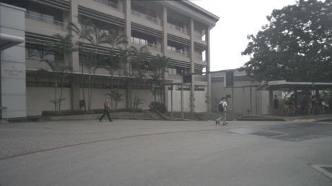
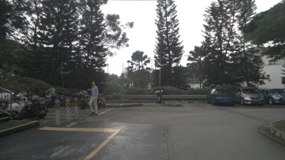
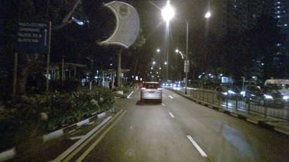
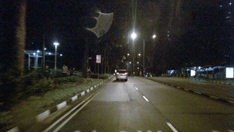
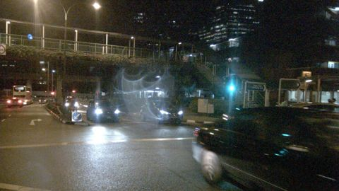

# VLM evaluation report: `SmolVLM-500M-Instruct` with prompt `v3_questionnaire@14414ec5`

50 frames from 10 scenes. Ground truth comes from nuScenes annotations (objects), `scene.description` (time of day, road condition, scene type) and `log.location` (traffic side).

## Headline numbers

| Metric | Value |
|---|---|
| Object presence: micro F1 | 63.4% |
|   ↳ blind baseline (always claims the frequent classes, never looks) | 54.7% |
| Object presence: precision | 50.3% |
| Object presence: recall | 86.0% |
| Hallucination rate (claimed class with no box in view) | 46.0% |
| Omission rate (clearly visible class not mentioned) | 14.0% |
| Count bucket accuracy (exact) | 68.4% |
| Count bucket accuracy within ±1 | 98.0% |
| Scene attributes: mean balanced accuracy | 67.2% |
| Free-text claims: micro F1 | 67.8% |
| Prose claims an object the structured answer denies | 4.1% |
| Valid structured output | 100.0% |
| Mean latency per frame (s) | 17.42 |

## Objects: hallucination vs. omission

Per frame and class: claimed vs. present (≥40% visible, ≤50 m). `FP` = claimed but no box of that class anywhere in the image (hallucination); `FP far` = a box exists but is far or mostly occluded (excused in *precision*, counted in *precision strict*).

| Class | GT frames | TP | FP | FP far | FN | Precision | Precision strict | Recall | F1 |
|---|---|---|---|---|---|---|---|---|---|
| car | 44 | 44 | 1 | 2 | 0 | 97.8% | 93.6% | 100.0% | 98.9% |
| truck | 12 | 12 | 29 | 5 | 0 | 29.3% | 26.1% | 100.0% | 45.3% |
| bus | 7 | 6 | 5 | 4 | 1 | 54.5% | 40.0% | 85.7% | 66.7% |
| pedestrian | 22 | 14 | 2 | 2 | 8 | 87.5% | 77.8% | 63.6% | 73.7% |
| two_wheeler | 12 | 9 | 6 | 2 | 3 | 60.0% | 52.9% | 75.0% | 66.7% |
| traffic_cone | 8 | 8 | 19 | 0 | 0 | 29.6% | 29.6% | 100.0% | 45.7% |
| barrier | 9 | 5 | 35 | 1 | 4 | 12.5% | 12.2% | 55.6% | 20.4% |

**Recall by object visibility** (all annotated objects in view)

| Visibility | Objects | Recall |
|---|---|---|
| 0-40% | 165 | 90.3% |
| 40-60% | 69 | 91.3% |
| 60-80% | 63 | 85.7% |
| 80-100% | 322 | 91.9% |

**Recall by distance**

| Distance | Objects | Recall |
|---|---|---|
| 0-15m | 68 | 97.1% |
| 15-30m | 197 | 92.4% |
| 30-50m | 189 | 93.1% |
| 50m+ | 165 | 83.6% |

## Counting

Only frames where GT and prediction both say the class is present (buckets 1-2 / 3-5 / 6+).

| Class | Frames | Exact bucket | Within ±1 bucket |
|---|---|---|---|
| car | 44 | 65.9% | 100.0% |
| truck | 12 | 91.7% | 100.0% |
| bus | 6 | 100.0% | 100.0% |
| pedestrian | 14 | 50.0% | 92.9% |
| two_wheeler | 9 | 88.9% | 100.0% |
| traffic_cone | 8 | 37.5% | 100.0% |
| barrier | 5 | 60.0% | 80.0% |

## Scene attributes

Accuracy counts unanswered fields as wrong. Compare against the majority-class baseline: with a skewed GT, a model that always says "day" looks good on raw accuracy but gets 50% balanced accuracy.

| Attribute | Accuracy | Balanced acc. | Majority baseline | Answered | GT distribution |
|---|---|---|---|---|---|
| time_of_day | 100.0% | 100.0% | 70.0% | 100.0% | day: 35, night: 15 |
| road_condition | 60.0% | 77.8% | 90.0% | 100.0% | dry: 45, wet: 5 |
| scene_type | 52.0% | 43.3% | 40.0% | 100.0% | intersection: 20, road: 20, parking_lot: 10 |
| traffic_side | 40.0% | 47.5% | 60.0% | 100.0% | left: 30, right: 20 |

Confusion:
- **time_of_day**: GT day → day: 35; GT night → night: 15
- **road_condition**: GT dry → dry: 25, wet: 20; GT wet → wet: 5
- **scene_type**: GT intersection → intersection: 20; GT parking_lot → road: 4, intersection: 6; GT road → intersection: 14, road: 6
- **traffic_side**: GT left → right: 27, left: 3; GT right → left: 3, right: 17

## Free-text faithfulness

| Metric | Value |
|---|---|
| Claims in prose: precision | 89.9% |
| Claims in prose: recall | 54.4% |
| Claims in prose: hallucination rate | 9.6% |
| Prose object claims the structured answer denies | 4.1% |
| Prose ↔ structured attribute agreement | 45.8% |

Claims are extracted from the description with a rule-based lexicon (see parsing/text_claims.py). Agreement is computed for structured answers (JSON or questionnaire).

## Slices

Headline metrics per ground-truth condition. Slices are defined on ground truth. Small slices have wide uncertainty; check the frame count before drawing conclusions.

**By time_of_day**

| Slice | Frames | Object F1 | Recall | Hallucination | Attribute acc. |
|---|---|---|---|---|---|
| day | 35 | 68.1% | 89.5% | 42.0% | 72.1% |
| night | 15 | 50.6% | 75.0% | 55.7% | 41.7% |

**By location**

| Slice | Frames | Object F1 | Recall | Hallucination | Attribute acc. |
|---|---|---|---|---|---|
| boston-seaport | 20 | 68.3% | 84.3% | 38.6% | 78.8% |
| singapore-hollandvillage | 15 | 50.6% | 75.0% | 55.7% | 41.7% |
| singapore-onenorth | 5 | 80.9% | 95.0% | 29.6% | 80.0% |
| singapore-queenstown | 10 | 56.6% | 100.0% | 57.5% | 55.0% |

**By scene_type**

| Slice | Frames | Object F1 | Recall | Hallucination | Attribute acc. |
|---|---|---|---|---|---|
| intersection | 20 | 68.1% | 87.3% | 42.2% | 82.5% |
| parking_lot | 10 | 66.7% | 94.7% | 43.6% | 52.5% |
| road | 20 | 56.1% | 80.0% | 51.2% | 48.8% |

## Temporal consistency

How often a label changes between consecutive sampled frames of the same scene.

| Label | Model flip rate | GT flip rate |
|---|---|---|
| time_of_day | 0.0% | 0.0% |
| road_condition | 27.5% | 0.0% |
| scene_type | 22.5% | 0.0% |
| traffic_side | 20.0% | 0.0% |
| obj:car | 7.5% | 20.0% |
| obj:truck | 10.0% | 37.5% |
| obj:bus | 30.0% | 15.0% |
| obj:pedestrian | 32.5% | 22.5% |
| obj:two_wheeler | 40.0% | 32.5% |
| obj:traffic_cone | 37.5% | 15.0% |
| obj:barrier | 15.0% | 10.0% |

Scene-level GT attributes never change within a scene, so any attribute flip by the model is an inconsistency.

## Similarity to the human reference (secondary)

`scene.description` describes a 20 s scene in keywords, not this frame, so similarity is a weak proxy. A low correlation with the claim-level F1 shows that similarity does not track correctness.

| Metric | Value |
|---|---|
| Reference keyword recall (classes in scene.description that are mentioned) | 60.6% |
| Mean embedding cosine to scene.description | 0.31 |
| Pearson(cosine, frame object F1) | 0.25 |
| Spearman(cosine, frame object F1) | 0.22 |

## Error taxonomy

Frames with at least one error: 100.0%

| Error family | Count |
|---|---|
| hallucination | 97 |
| attribute | 74 |
| omission | 16 |
| consistency | 3 |
| count | 2 |
| format | 1 |

| Most frequent errors | Count |
|---|---|
| hallucination:barrier | 35 |
| attribute:traffic_side | 30 |
| hallucination:truck | 29 |
| attribute:scene_type | 24 |
| attribute:road_condition | 20 |
| hallucination:traffic_cone | 19 |
| omission:pedestrian | 8 |
| hallucination:two_wheeler | 6 |
| hallucination:bus | 5 |
| omission:barrier | 4 |
| omission:two_wheeler | 3 |
| consistency:text_contradicts_json | 3 |
| hallucination:pedestrian | 2 |
| count:barrier | 1 |
| hallucination:car | 1 |

### Worst frames

**scene-1100 / frame 29**: `hallucination:truck`, `omission:pedestrian`, `hallucination:traffic_cone`, `hallucination:barrier`, `attribute:road_condition`, `attribute:scene_type`, `attribute:traffic_side`

> The image is taken from the front of a car. The car is parked on the road. The road is wet, indicating it might be raining. There are no other cars visible in the image. The road is surrounded by a sidewalk, and there are buildings and trees in the background. The buildings are tall and have a modern design. The sky is dark, suggesting it might be nighttime.

GT objects: `{'pedestrian': '1-2', 'car': '1-2'}`, predicted: `{'car': '1-2', 'truck': '1-2', 'traffic_cone': '1-2', 'barrier': '1-2'}`

**scene-1100 / frame 39**: `hallucination:truck`, `hallucination:bus`, `omission:pedestrian`, `hallucination:traffic_cone`, `hallucination:barrier`, `attribute:road_condition`, `attribute:scene_type`

> A car is on the road. The car is black. There is a blue and white sign on the road. There are buildings and trees in the background.

GT objects: `{'pedestrian': '1-2', 'car': '1-2'}`, predicted: `{'car': '1-2', 'truck': '1-2', 'bus': '1-2', 'traffic_cone': '1-2', 'barrier': '1-2'}`

**scene-0916 / frame 0**: `format:repetition_loop`, `hallucination:two_wheeler`, `hallucination:barrier`, `attribute:scene_type`, `attribute:traffic_side`, `consistency:text_contradicts_json`

> The image is taken from the front of a car. The car is parked on the road. The road is empty. There are two people riding bicycles on the road. There are two people walking on the sidewalk. There are two people standing on the sidewalk. There are two people standing on the sidewalk. There are two people standing on the sidewalk. There are two people standing on the sidewalk. There are two people standing on the sidewalk. There are two people standing on the sidewalk. There are two people standing on the sidewalk. There are two people standing on the sidewalk. There are two people standing on the sidewalk. There are two people standing on the sidewalk. There are two people standing on the sidewalk. There are two people standing on the sidewalk. There are two people standing on the sidewalk.

GT objects: `{'pedestrian': '6+'}`, predicted: `{'pedestrian': '3-5', 'two_wheeler': '1-2', 'barrier': '1-2'}`

**scene-0916 / frame 10**: `hallucination:truck`, `hallucination:traffic_cone`, `hallucination:barrier`, `attribute:road_condition`, `attribute:scene_type`, `attribute:traffic_side`

> A car is parked on the road. A man is walking on the sidewalk. There are trees, cars, and buildings in the background.

GT objects: `{'car': '3-5', 'two_wheeler': '3-5', 'pedestrian': '1-2'}`, predicted: `{'car': '3-5', 'truck': '1-2', 'pedestrian': '1-2', 'two_wheeler': '1-2', 'traffic_cone': '1-2', 'barrier': '1-2'}`

**scene-1094 / frame 10**: `hallucination:truck`, `count:pedestrian`, `omission:two_wheeler`, `hallucination:barrier`, `attribute:scene_type`, `attribute:traffic_side`

> A car is parked on the road. There are two people walking on the road. There are cars parked on the road.

GT objects: `{'car': '3-5', 'pedestrian': '6+', 'two_wheeler': '1-2'}`, predicted: `{'car': '3-5', 'truck': '1-2', 'pedestrian': '1-2', 'barrier': '1-2'}`

**scene-1094 / frame 20**: `hallucination:truck`, `hallucination:bus`, `omission:pedestrian`, `hallucination:barrier`, `attribute:scene_type`, `attribute:traffic_side`

> A car is on the road. The road is empty. The road is surrounded by plants and trees.

GT objects: `{'car': '3-5', 'pedestrian': '1-2'}`, predicted: `{'car': '3-5', 'truck': '1-2', 'bus': '1-2', 'barrier': '1-2'}`

**scene-1094 / frame 39**: `hallucination:truck`, `omission:pedestrian`, `hallucination:two_wheeler`, `hallucination:barrier`, `attribute:scene_type`, `attribute:traffic_side`

> A car is on the road. The road is empty. There are white lines on the road. There are trees and street lights on both sides of the road.

GT objects: `{'car': '1-2', 'pedestrian': '3-5'}`, predicted: `{'car': '1-2', 'truck': '1-2', 'two_wheeler': '1-2', 'barrier': '1-2'}`

**scene-1100 / frame 0**: `hallucination:truck`, `hallucination:traffic_cone`, `hallucination:barrier`, `attribute:road_condition`, `attribute:scene_type`, `attribute:traffic_side`

> A car is parked on the road. The car is black and the road is wet. There are traffic lights and street lights in the background.

GT objects: `{'car': '3-5'}`, predicted: `{'car': '3-5', 'truck': '3-5', 'bus': '3-5', 'two_wheeler': '1-2', 'traffic_cone': '1-2', 'barrier': '1-2'}`
